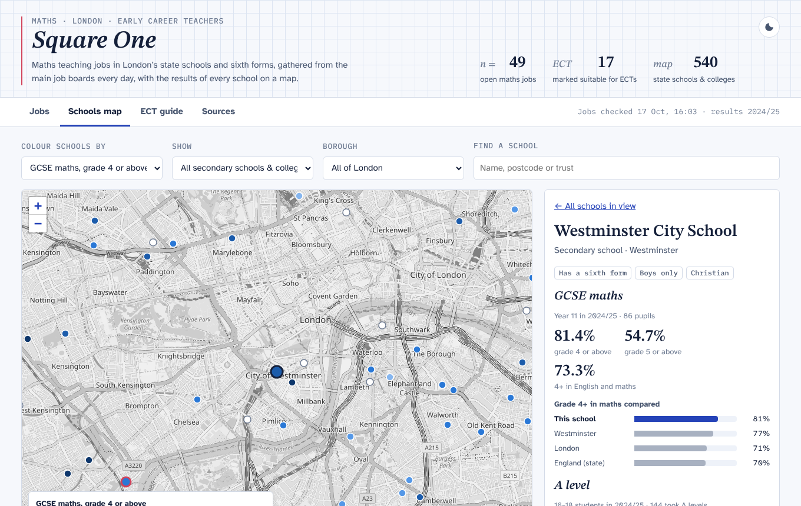

# Square One: London maths teaching jobs for ECTs

A website that gathers **maths teaching jobs in London** from the main school
job boards, highlights the ones that suit **early career teachers (ECTs)**,
focuses on **state schools and sixth forms**, and puts every school on a
**map with its GCSE maths and A level results**.



## What it does

**Jobs tab**

- Collects London maths adverts from four boards:
  [Teaching Vacancies (GOV.UK)](https://teaching-vacancies.service.gov.uk),
  [TES](https://www.tes.com/jobs), [MyNewTerm](https://mynewterm.com) and
  [Eteach](https://www.eteach.com).
- Merges the same advert when it appears on several boards and links to each.
- Rates every job for ECTs:
  - **Suitable for ECTs**: a board marks it ECT-suitable, or the advert mentions ECTs/NQTs.
  - **Likely open to ECTs**: a classroom teacher post with no sign it needs experience.
  - **Not aimed at ECTs**: leadership/TLR roles, “minimum 3 years’ experience”, or “not suitable for ECTs”.
  - **Teacher training route**: trainee and salaried training posts.
- Picks out mentoring, induction/ECF, CPD and reduced-timetable mentions.
- Matches each advert to its school using the DfE school register, so it can tell
  state schools from independent, special and alternative provision schools,
  and show the school’s results on the job card.
- Filters: ECT suitability, school type (state is the default), sixth form or
  A level teaching, role, borough, Inner/Outer London pay area and contract.

**Schools map tab**

- All 540 open state-funded secondary, all-through and 16–19 schools, sixth form
  colleges and FE colleges in the 33 London boroughs.
- Colour schools by **GCSE maths grade 4+**, **grade 5+**, or **A level average
  grade / UCAS points**. Schools with a maths job open now have a red ring.
- Each school’s profile shows:
  - GCSE maths 4+ and 5+ (and English and maths 4+), compared with the borough,
    London and England.
  - A level average grade, **UCAS tariff points per A level and for three A levels**,
    the share of A level students taking maths and further maths, AAB+ rate and value added.
  - Sixth form, selective/faith/single-sex status, trust, size, free school meals,
    pay area with the 2026/27 M1 salary, and links to the DfE performance tables,
    Ofsted reports and the school website.

**ECT guide tab**: induction entitlements, 2026/27 London starting pay, how to
read an advert, interview questions, and how the school figures are worked out.

### How UCAS points are worked out

The DfE publishes an average point score per A level entry on its own scale
(A* = 60, A = 50 … E = 10). UCAS tariff points (A* = 56, A = 48 … E = 16) are a
straight-line transformation of that scale, `tariff = 0.8 × points + 8`, so the
average converts exactly. “≈ for three A levels” is three times the per-entry
figure.

## Running it

Needs Node.js 20 or later. The website and the data scripts have no
dependencies; `npm install` is only needed to build the Android app.

```bash
npm start            # serves the site at http://localhost:8080
```

The repository already contains the data in `public/data/`, so the site works
straight away. To refresh it:

```bash
npm run jobs         # re-check the job boards (about 30 seconds)
npm run schools      # re-download the school register and DfE results (about 1 minute, ~90 MB)
npm test             # unit tests for the parsers and classification rules
```

When the site is served by `npm start`, the Sources tab also has a
**Check the job boards now** button (limited to once every 10 minutes).

## Android app

The same site is packaged as an Android app with [Capacitor](https://capacitorjs.com).
The app does one thing the website cannot: it **checks the job boards itself,
from the phone**, so it stays current without any server or GitHub Pages
setup.

- It opens instantly with the jobs it last found (or the ones it shipped with).
- When those are more than 6 hours old it checks Teaching Vacancies, TES,
  MyNewTerm and Eteach in the background (skipped when offline or in data saver
  mode). **Check now** on the Jobs tab does it on demand. Each check takes
  about 30 seconds and uses roughly 15 MB of data, mostly TES job pages.
- The map, school profiles and ECT guide work the same as on the website.
  School results are bundled, so they only change with a new version of the app.

### Installing

1. Download `SquareOne.apk` on the phone: from the **android-latest** release on
   GitHub once the workflow below has run on the default branch, or from the
   `SquareOne-apk` artifact of any **Build Android app** run.
2. Open it. Android will ask you to allow installs from your browser or files
   app the first time.

The APK is signed with a debug key. Builds from different machines have
different keys, so to switch from one build to another you may need to
uninstall the app first (your saved filters and cached jobs are cleared).

### Building it yourself

Needs JDK 21 and the Android SDK (platform 36, build tools 36), for example
from Android Studio.

```bash
npm install
npm run android:apk  # -> android/app/build/outputs/apk/debug/app-debug.apk
npx cap open android # or open the project in Android Studio
```

`npm run android:sync` rebuilds `app-web/` (the website plus the job engine
from `scripts/lib` and `scripts/sources`) and copies it into the Android
project. `scripts/make-app-icons.py` redraws the launcher icon and splash
screens.

The **Build Android app** workflow (`.github/workflows/android.yml`) builds the
APK on every push that touches the app, refreshes the bundled jobs first, and
on the default branch republishes it as the `android-latest` release.

## Publishing on GitHub Pages

The workflow in `.github/workflows/update-site.yml` checks the job boards twice a
day, rebuilds the school data every Monday, and publishes the site.

1. In the repository go to **Settings → Pages** and set **Source** to **GitHub Actions**.
2. Merge this branch into the default branch (or make it the default branch).
3. Run the workflow once from the **Actions** tab (**Update jobs and publish site → Run workflow**).

The site will then be at `https://<your-user>.github.io/<repo>/`.

## How it is built

```
public/                 the website (plain HTML, CSS and JavaScript)
  index.html, styles.css, app.js
  data/jobs.json        built by scripts/scrape-jobs.mjs
  data/schools.json     built by scripts/build-schools.mjs
  vendor/leaflet/       map library (BSD-2-Clause)
scripts/
  build-schools.mjs     GIAS register + DfE KS4, 16-18 and A level maths data
  scrape-jobs.mjs       runs the sources, classifies, matches and merges jobs
  sources/              one module per job board
  lib/                  CSV/zip/xlsx readers, grid-to-lat/long, matching, rules
  data/london-establishments.json   every London school, for matching adverts
  lib/pipeline.mjs      the shared job pipeline (Node and the Android app)
  build-app-web.mjs     assembles app-web/ for the Android app
  make-app-icons.py     draws the app icon and splash screens
server.mjs              local static server with a refresh endpoint
android/                Capacitor Android project
capacitor.config.json   app id, name and web folder
test/                   node:test unit tests
```

If a job board is down, the scraper keeps that board’s still-open adverts from
the previous run and marks them on the Sources tab.

## Data and good manners

- School data: [Get Information About Schools](https://get-information-schools.service.gov.uk)
  and the [DfE school and college performance tables](https://www.compare-school-performance.service.gov.uk/download-data),
  2024/25, © Crown copyright, [Open Government Licence v3.0](https://www.nationalarchives.gov.uk/doc/open-government-licence/version/3/).
- Postcode lookups: [postcodes.io](https://postcodes.io) (open data).
- Map: © [OpenStreetMap](https://www.openstreetmap.org/copyright) contributors.
- Job adverts belong to the boards and schools that published them. The scraper
  only reads public search results, waits between requests to each site, runs
  at most twice a day, and always links back to the original advert. Check each
  site’s terms before running it more often or reusing the data elsewhere.
- Progress 8 is not published for 2025 or 2026 (no KS2 baseline for those
  cohorts), so it is not shown.
- Pay figures are the 2026/27 M1 points (3.5% award). Academies can set their own pay.
